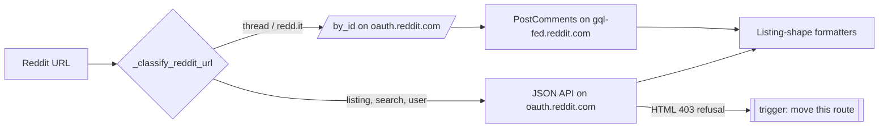

<!-- Historical record: frozen at acceptance. Do not edit text above
"## Implementation Notes" to match the code; append a dated entry there
instead, or supersede this ADR with a new one. See docs/adr/README.md. -->

# ADR-0001: Choose Reddit's upstream API per route, moving a route to GraphQL only when refused

## Context

parkour-mcp reads Reddit with a userless OAuth token: an anonymous,
logged-out token minted through Reddit's own Android-app grant
(`parkour_mcp/reddit.py#_mint_mobile_token`), with no user account, API key,
or app registration. Until 2026-10-20, every page type came from the
`oauth.reddit.com` JSON API, whose Listing shape the formatters were written
against.

On 2026-10-20 at about 18:40 UTC, `oauth.reddit.com` began refusing every
comment-thread route to logged-out tokens with an HTML 403 ("blocked by
network security"): `/r/SUB/comments/…`, `/comments/…`, `/api/morechildren`,
and later the percent-encoded-slash workaround that redlib briefly used
(redlib-org/redlib#591, #592, #600). Varying headers, TLS profile, or host
made no difference. Listings, search, user pages, `/by_id`, and `/api/info`
kept answering.

Comment threads were restored in commit `2d13b85` by taking the comments from
`gql-fed.reddit.com`, the GraphQL gateway behind Reddit's Android app, via
the persisted `PostComments` operation and the same token
(`parkour_mcp/reddit.py#_fetch_thread_json`). The post itself still comes
from `/by_id`. This ADR treats that as the baseline and decides what happens
to the remaining routes.

Reddit has announced that remaining public Data API access ends in March
2027, with removal starting on 2027-01-12 for apps and users that have not
registered (r/redditdev, "Moving Data API Apps to the Developer Platform",
2026-09-30). The announcements are framed around third-party apps migrating
to Devvit. Neither they nor roughly 380 comments across the two announcement
threads say whether logged-out access under Reddit's own client ids is in
scope. Every `oauth.reddit.com` route must therefore be treated as at risk
from 2027-01-12.

Constraints:

- **Request budget.** One user per sidecar, behind a 2-second limiter
  (`parkour_mcp/common.py#RateLimiter`).
- **Licensing.** redlib is AGPL-3.0 and `Amqx/reddit-gql` is GPL-3.0. Only
  protocol facts and persisted-query hash values may be taken from them, never
  code.
- **Documented behavior.** NSFW is included by default; this is documented and
  deliberate (`.claude/TECH_DEBT.md`, the quarantine/NSFW entry).
- **Shared dependency.** Both hosts depend on the logged-out mobile grant. If
  Reddit retires that grant, no choice of transport recovers access.

## Decision

1. Each Reddit route uses the upstream that serves it best *today*, judged
   per route, not per integration.
2. Comment threads stay on `/by_id` plus GraphQL `PostComments`, as shipped in
   `2d13b85`.
3. Listings, search, user pages, and search for subreddits and users stay on
   the `oauth.reddit.com` JSON API while it answers them.
4. A route moves to its GraphQL operation when, and only when, its trigger
   fires: the route starts returning the HTML refusal that
   `parkour_mcp/reddit.py#_reddit_api_call` reports as "Reddit refused this
   endpoint to a logged-out client". Routes move one at a time, following the
   Plan below.
5. No wholesale migration is done in advance.

## Considered Options

### A. Per-route, triggered by refusal (chosen)

- **Gains:** every route keeps the upstream with the best measured parity
  (see Evidence). Only one persisted-query hash is maintained until a
  trigger fires. When a route does move, the work is scoped to that route.
- **Loses:** two upstreams stay in the codebase indefinitely. A route breaks
  for users between the refusal appearing and the move landing; that gap is
  bounded by how fast the refusal is noticed.

### B. Migrate every route to GraphQL now

- **Gains:**
  - Survives the closure of `oauth.reddit.com`, provided `gql-fed` outlives it.
  - One host and one response family.
  - Gated subreddits (for example a graphic-content warning) serve listings
    where the JSON API returns 403.
  - Explicit rate-limit headers: 600 requests per 600 s window.
  - Richer post fields: `isStickied`, `viewCount`, `suggestedCommentSort`,
    rich text.
- **Loses:**
  - About eight pinned hashes instead of one, any of which an Android
    release can retire.
  - **NSFW search:** GraphQL search filtered out every NSFW result, and no
    override was found.
  - **User pages** need three requests and lose the mixed posts-and-comments
    overview and the post/comment karma split.
  - **Error reasons** for banned, private, and quarantined subreddits cost a
    second request.
  - **Search cursors** are offsets and stop matching Reddit's `?after=`
    URLs.
  - **Community support is thinner:** a two-star library, one fork, and an
    unmerged redlib PR (#603), against mainline redlib on the JSON API.
  - **Effort:** a converter per operation.

### C. Scrape the logged-out web frontend's comment fragments (`/svc/shreddit/`)

- **Gains:** no persisted hashes; the endpoint is the one Reddit serves to
  logged-out browsers.
- **Loses:**
  - Costs 1–30 requests per thread.
  - Needs a cookie jar to avoid a reCAPTCHA wall after about 10 requests.
  - Reddit's edge already blocks some of these requests by `Origin` and
    `Referer` (redlib-org/redlib#599).
  - HTML parsing loses fields.
- Rejected as a primary; kept as a possible fallback for threads if
  `PostComments` dies.

### D. Accept a user-supplied logged-in session token

- **Gains:** the only route that does not rely on gaps in logged-out access;
  it reaches whatever a logged-in reader can.
- **Loses:**
  - Requires the user to hold a Reddit account and hand its session to the
    tool.
  - Ties requests to that account.
  - Changes the project's "no account" posture.
- Not chosen. Remains the answer if the logged-out grant is retired.

### E. Status quo before `2d13b85` (JSON API only)

Rejected: comment threads do not load.

## Plan

### Diagram

Routing as decided:

### Moving one route when its trigger fires

1. **Confirm the refusal is the trigger.** Run the route through
   `parkour-mcp call` with `--trace`. A JSON 403 is a gated, private, or
   quarantined subreddit and is not the trigger.
2. **Capture fixtures live** with `parkour-mcp call --record` against the
   GraphQL operation, one fixture per response variant, including
   `UnavailableSubreddit` and `null`.
3. **Write a converter** from the operation's response to the JSON API's
   Listing shape, following `parkour_mcp/reddit.py#_gql_comment_listing`, so
   the formatters stay unchanged. Drop non-post feed units; feed edges mix
   in recommendation carousels.
4. **Map URL parameters to variables:**
   - `sort` to the operation's enum;
   - `t` to `range`, only for top and controversial sorts;
   - `?after=t3_X` to a feed cursor, which is `base64("t3_X")`.
   - Search cursors are base64-encoded offsets with no Reddit URL form, so
     the continuation hint names the cursor rather than a reddit.com URL.
5. **Map errors:**
   - `null` → not found.
   - `UnavailableSubreddit` → one `SubredditInfoByName` request recovers the
     reason: `banMessage` → banned, `isQuarantined` → quarantined,
     `forbiddenReason` → private or gated.
6. **Keep hashes in one table** keyed by operation name. A
   `persisted query not found` error names the operation whose hash
   expired.
7. **Update `_api_label`** for the route, and update the drift-bound docs
   that describe it (`docs/guide.md`, `CLAUDE.md`, `.claude/TECH_DEBT.md`,
   `README.md`).
8. **Append an Implementation Notes entry** to this ADR recording the move,
   any deviation from this Plan, and the commits.

### Route map

Operation names and variables were verified live on 2026-10-26 unless
marked otherwise. Hash values live in code, not here.

| Route | GraphQL operation(s) | Requests |
|---|---|---|
| `r/SUB` + sort, `t` | `SubredditFeedElements` (`subredditName`, `sort`, `range`, `after`, `pageSize`, `includeSubredditInPosts`) | 1 |
| `r/all` | `AllFeedSdui`, then `PostsByIds` (unverified) | 2 |
| `r/popular` | `PopularFeedElements`; returns `PostRecommendation` wrappers (unparsed) | 1+ |
| `/search` (posts), `/r/SUB/search` | `SearchPosts` (`query` with `subreddit:SUB` appended, `sort`, `filters: [{key: time_range}]`, `afterCursor`, `pageSize`, `productSurface`) | 1 |
| `/search?type=sr` | `SearchCommunities` | 1 |
| `/search?type=user` | `SearchPeople` (total karma only) | 1 |
| `/user/NAME` | `UserSubmittedPosts`, `SubmittedComments`, then `LiveCommentsByIds` for full comment bodies (last step unverified) | 3 |
| `/by_id` half of a thread | `PostsByIds` (returns `postTitle`, not `title`) | 1 |
| redd.it short link | unchanged: HEAD on `redd.it` | 1 |

### Checkpoints

On 2027-01-12, and again when Reddit announces the March 2027 date, fetch a
subreddit listing, a search, a user page, and a thread through
`parkour-mcp call`, and append the results here as a Clarification entry.

## Consequences

Predicted at the time of writing:

- **Nothing changes for users until a trigger fires.** Search keeps NSFW
  results, user pages keep the mixed overview and karma split, and error
  reasons stay one request away.
- **One persisted hash** (`PostComments`) needs watching until a route moves.
  Each move adds one to three hashes.
- **The first route likely to move is listings.** If the March 2027 closure
  covers the logged-out lane, every JSON route moves at once and option B's
  losses arrive together. The Plan bounds the work but does not avoid those
  losses.
- **NSFW search may regress on that date.** If search moves to GraphQL
  without an NSFW override, the documented include-NSFW default becomes
  unachievable for search, and the TECH_DEBT entry has to say so.

## Evidence

### Method

- One request per operation, 2026-10-26.
- Mobile-grant token, `Emulation.Safari26_4`.
- At least 2 s between requests, from the maintainer's network.
- Scripts and raw responses were kept outside the repository.

### Thread routes on `oauth.reddit.com` (logged-out token)

| Request | Result |
|---|---|
| `/r/linux/hot/.json` | 200 |
| `/r/linux/comments/ID/.json` | 403 HTML |
| `/r/linux%2fcomments/ID/.json` | 403 HTML |
| `/comments/ID/.json` | 403 HTML |
| `/by_id/t3_ID/.json` | 200 |
| `/api/info?id=t3_ID` | 200 |

### GraphQL behavior

- **All 18 read requests answered 200**, covering 10 operations including the
  error cases.
- **Rate limit:** `x-ratelimit-remaining` starts at 600, and the reset window
  is 600 s.
- **Raw query text** draws `NOT_AUTHENTICATED`, per `Amqx/reddit-gql`'s
  README. That is the likely explanation for the "GraphQL needs login"
  report on redlib-org/redlib#599.
- **An unknown hash** draws `persisted query not found` with code
  `NOT_FOUND`; verified.

### Parity, JSON API vs GraphQL

| Probe | JSON API | GraphQL |
|---|---|---|
| Scoped search: `asyncio` in r/Python, top, month | 1 result | same 1 result |
| `author:spez`, new | 10 | 9, all 9 shared |
| `title:"type hints" subreddit:Python`, top | 10 | 10, 9 shared |
| `car` in r/WTF | 0 | 5 |
| NSFW-flagged gated subreddit (r/MorbidReality), listing | 403 JSON "gated" | 200, 5 NSFW posts |
| Same subreddit, search with `include_over_18=1` | 5 NSFW | — |
| Same subreddit, search, default | 0 | 0; filter keys `nsfw`, `include_over_18`, and `safe_search` had no effect |
| Banned subreddit, listing | not probed; `_check_reddit_json_error` maps the JSON `reason` | `UnavailableSubreddit`; reason via `SubredditInfoByName` |
| Private subreddit, listing | not probed; mapped the same way | `UnavailableSubreddit`; `forbiddenReason` via `SubredditInfoByName` |
| Missing subreddit | not probed | `null` |
| `r/all` via `SubredditFeedElements` | 200 | `postFeed: null` |

### Not verified

- The JSON API's responses for banned, private, and missing subreddits.
- `AllFeedSdui` + `PostsByIds` for `r/all`.
- Parsing `PostRecommendation` for `r/popular`.
- `LiveCommentsByIds` hydration for user comments.
- Ordinary (non-gated) NSFW subreddit listings on the JSON API.
- Whether the two hosts share a rate-limit budget.
- The `after` cursor on `PostComments`.
- Whether the Android app now requires login (one report on
  redlib-org/redlib#599).

## Reopen If

- **The logged-out mobile grant is retired.** Both hosts fail; option D
  becomes the remaining path.
- **GraphQL search gains an NSFW override, or JSON search starts refusing.**
  The per-route balance for search changes.
- **Persisted hashes rotate faster than monthly.** The maintenance cost of
  GraphQL routes rises sharply.
- **Reddit offers sanctioned read access a logged-out tool can use.**
- **More than half the routes have moved.** At that point a wholesale
  migration may be cheaper than maintaining two upstreams.

## Implementation Notes

<!-- Append-only. Add entries below, newest last, in the format given in
docs/adr/README.md. Never edit an entry once written. -->
